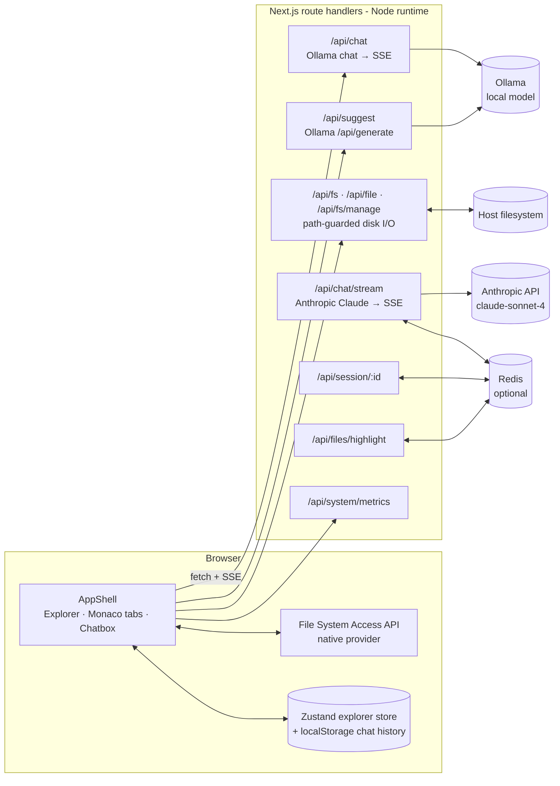
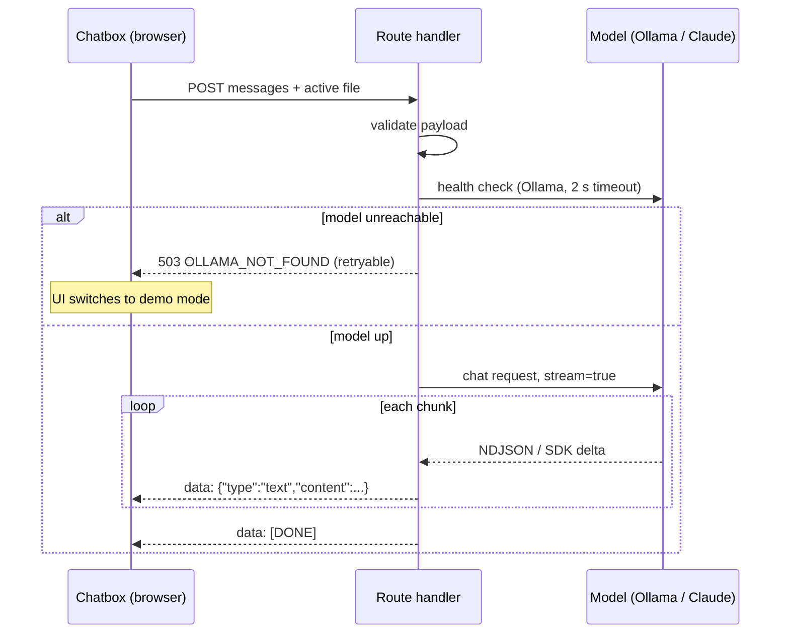

# CodeHelp

**Live demo:** https://code-help-3kqniu20b-aadvik-chaturvedis-projects.vercel.app

A browser-based developer workspace: open a real folder from disk, edit it in a Monaco (VS Code) editor, and talk to an LLM assistant that can see the file you're working on. Responses stream token by token over Server-Sent Events.

Built with Next.js 16 (App Router), React 19, TypeScript, Tailwind CSS v4, Zustand and Zod.

## What it does

- **Edits real files.** In Chromium browsers the folder is mounted through the File System Access API (`showDirectoryPicker`), so reads and writes go straight to disk with no server round trip. In other browsers you can type an absolute path instead, and a Node backend provider serves the tree and file contents through `/api/fs` and `/api/file`.
- **Auto-saves.** Each keystroke goes through a per-file debounced scheduler (800 ms) that works with either provider and reports `saving` / `saved` / `error` status per tab.
- **Context-aware chat.** The chat panel sends the conversation plus the active file (or an attached file) to the model, and renders streamed Markdown with sanitized syntax highlighting (`react-markdown` + `rehype-highlight` + `rehype-sanitize`).
- **Proactive suggestions.** About 3 seconds after you open a tab, the editor asks a local Ollama model for a likely next-line completion and shows it as a dismissible suggestion card.
- **Workspace context export.** The explorer can compile the whole workspace (an ASCII tree plus file contents) into one LLM-ready context block and copy it to the clipboard.
- **Live server metrics.** The top bar polls `/api/system/metrics` every 2 s for load average, memory and event-loop lag.

## Architecture



### Chat request flow



The client reads the stream with `ReadableStream.getReader()`, buffers partial lines, and appends text deltas to the last assistant message as they arrive.

## Reliability and performance

| Concern | What the code does | Where |
|---|---|---|
| Streaming | Model output is re-emitted as SSE frames (`data: {...}\n\n`, terminated by `data: [DONE]`) with `Cache-Control: no-cache, no-transform` and `X-Accel-Buffering: no` so proxies don't buffer. Stream errors are sent as an in-band `{"type":"error"}` frame instead of dropping the connection. | `src/app/api/chat/route.ts`, `src/lib/anthropic.ts` |
| Response cache | `/api/chat/stream` hashes the full conversation into a `chat:<hash>` key. On a hit it replays the cached answer as a single SSE frame; on a miss it tees the live stream, accumulates the text, and writes it to Redis with `SETEX` and a 600 s TTL once the stream ends. Requests with an attached file skip the cache. | `src/app/api/chat/stream/route.ts` |
| Other caches | Syntax-highlight output cached 24 h per content hash + language. Sessions stored for 7 days. The metrics collector memoizes its result for 1 s. | `files/highlight`, `session/[id]`, `src/lib/metrics.ts` |
| Redis is optional | The client is created lazily, only if `REDIS_URL` is set. Every cache call swallows errors and returns a miss, so a Redis outage degrades to "no cache" rather than failing requests. Reconnect backoff is `min(times × 200, 2000)` ms for up to 3 attempts. | `src/lib/cache.ts` |
| Context budget | Conversation history is trimmed newest-first to an estimated 80K tokens (chars / 4) before calling Claude. | `src/lib/anthropic.ts` |
| Fail-fast health check | `/api/chat` pings Ollama's `/api/tags` with a 2 s `AbortSignal.timeout` before opening a stream, and returns a typed, retryable 503 if it's down. On first load the UI probes this and falls back to a local demo mode. | `src/app/api/chat/route.ts`, `workspace-provider.tsx` |
| Typed errors | API errors share one shape: `{ error: { code, message, retryable } }` (schema in `src/lib/schemas.ts`). Zod validates the chat, session and highlight payloads. | `src/lib/schemas.ts` |
| Path safety | Every disk endpoint resolves both the target and the workspace root, requires an absolute root that exists and is a directory, and rejects anything outside it with `403 PATH_TRAVERSAL_DETECTED`. The tree walker skips `node_modules`, `.git`, build dirs etc., and caps depth at 12 and output at 5,000 nodes (`truncated: true` in the response). | `src/app/api/fs*`, `src/app/api/file` |
| Debounced writes | `AutoSaveManager` keeps one timer per file id and cancels the pending write when a new keystroke arrives. | `src/lib/fs/autoSave.ts` |

## API reference

| Method | Path | Purpose |
|---|---|---|
| `POST` | `/api/chat` | Chat with the local Ollama model; SSE response. Used by the chat panel. |
| `POST` | `/api/chat/stream` | Chat with Anthropic Claude (`claude-sonnet-4-20250514`, `max_tokens` 4096); Zod-validated, Redis-cached, SSE response. |
| `POST` | `/api/suggest` | `{ code, language, cursorLine? }` → `{ suggestion }`. Sends 15 lines before and 5 after the cursor to Ollama. |
| `POST` | `/api/fs` | `{ path }` → recursive directory tree for an absolute path. |
| `GET` / `POST` | `/api/file` | Read (`?path=&workspaceRoot=`) or write (`{ path, workspaceRoot, content }`) a file inside the workspace. |
| `POST` | `/api/fs/manage` | `{ action: createFile \| createDir \| delete, path, workspaceRoot, name? }`. |
| `GET` / `POST` / `DELETE` | `/api/session/:id` | Persist editor session (tabs, expanded folders, chat history) in Redis. |
| `POST` | `/api/files/highlight` | `{ content, language }` → highlighted HTML (TS/JS/Python keyword sets). |
| `GET` | `/api/system/metrics` | CPU load, memory, event-loop lag, uptime. |

## Running locally

**Prerequisites:** Node.js 20+, npm. Optional: [Ollama](https://ollama.com) for chat and suggestions, Redis for caching, an Anthropic API key for `/api/chat/stream`.

```bash
npm install
npm run dev        # http://localhost:3000 (landing page), /editor for the workspace
```

To enable the local model:

```bash
ollama serve
ollama pull mistral
```

Create `.env.local` in the project root:

```env
OLLAMA_BASE_URL=http://127.0.0.1:11434
OLLAMA_MODEL=mistral
ANTHROPIC_API_KEY=your-anthropic-api-key
REDIS_URL=redis://localhost:6379
```

| Variable | Used by | Notes |
|---|---|---|
| `OLLAMA_BASE_URL` | `/api/chat`, `/api/suggest` | `/api/suggest` defaults to `http://127.0.0.1:11434`; `/api/chat` has no default, so set it or the chat panel runs in demo mode. |
| `OLLAMA_MODEL` | `/api/chat`, `/api/suggest` | Defaults to `mistral`. |
| `ANTHROPIC_API_KEY` | `/api/chat/stream` | Without it the endpoint returns `503 AI_NOT_CONFIGURED`. |
| `REDIS_URL` | cache, sessions | Optional. Everything works without it, just uncached. |

Other scripts:

```bash
npm run build && npm run start   # production build (standalone output)
npm run lint
```

### Docker

`docker-compose.yml` runs the app alongside `redis:7-alpine`. The app waits for Redis's `redis-cli ping` healthcheck before starting. The Dockerfile is a three-stage build (deps → builder → runner) that ships Next.js's standalone output and runs as a non-root `nextjs` user on port 3000.

```bash
ANTHROPIC_API_KEY=your-key docker compose up --build
```

## Project layout

```
src/
  app/
    page.tsx, editor/page.tsx      landing page and the IDE shell
    api/                           route handlers listed above
  components/
    layouts/                       AppShell, ActivityBar, SideBar, MainArea, EditorTabs, StatusBar
    explorer/ExplorerSidebar.tsx   tree view, create/delete, "compile workspace context"
    Chatbox.tsx                    streaming chat UI, quick actions, demo mode
    CodeEditor.tsx                 Monaco wrapper
    inline-suggest.tsx             proactive suggestion cards
  context/FileSystemContext.tsx    single source of truth for tree, tabs and save status
  lib/
    anthropic.ts                   Claude client, context truncation, SSE adapter
    cache.ts                       Redis helpers, content hashing, in-flight dedupe helper
    schemas.ts                     Zod request/response schemas
    metrics.ts                     OS + event-loop metrics
    fs/                            native and backend providers, auto-save, Zustand store
```

## Limitations and next steps

- **Two chat backends, one wired.** The chat panel calls the Ollama route (`/api/chat`). The Claude route (`/api/chat/stream`), with its Redis cache, is implemented and validated but no UI component calls it yet. The same goes for `/api/session/:id` and `/api/files/highlight`.
- **Request dedupe is unused.** `dedupeRequest()` in `src/lib/cache.ts` (coalesces identical in-flight requests onto one promise) exists but is not called by any route.
- **Suggestions are cards, not ghost text.** They are fetched once per tab open, not on every cursor move, and are not registered as Monaco inline completions.
- **Cache key strength.** `hashContent` is a 32-bit string hash, fine for a cache but collisions are possible; swapping in SHA-256 would be cheap.
- **Backend FS provider trusts the client.** `/api/fs` will list any absolute path the server process can read. That's acceptable for a local dev tool and not for a multi-user deployment; there is no auth (the `/login` page is a stub).
- **Docker build details.** The deps stage installs with `--only=production`, but `next build` needs the TypeScript/Tailwind dev dependencies, and the runner stage copies `public/`, which isn't in the repo. Both need adjusting before `docker compose up` builds cleanly. Compose also doesn't pass `OLLAMA_BASE_URL`.
- **Tests.** There is one SSR smoke test (`src/components/layouts/Workspace.test.tsx`, `node:test`) and no `test` script or CI yet.
- `src/context/FileSystemContext.tsx` still contains a debug `fetch` to a local ingest server on `127.0.0.1:7704` that should be removed.
